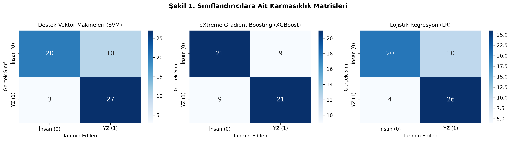
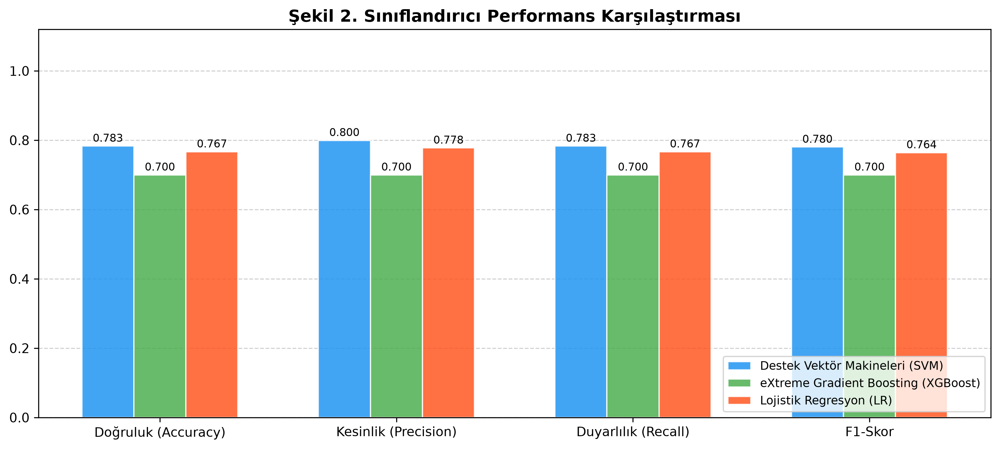
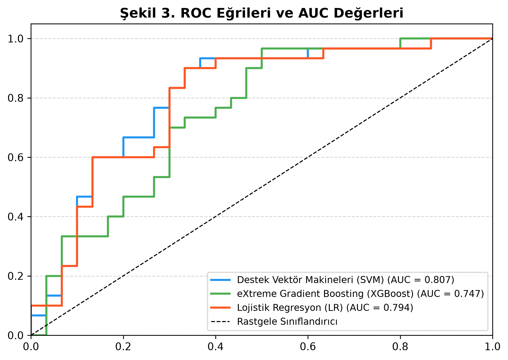
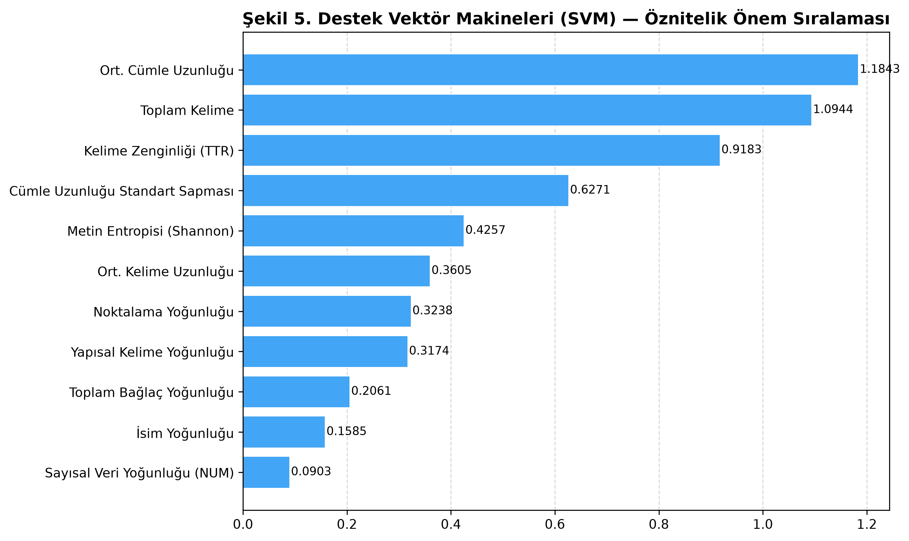
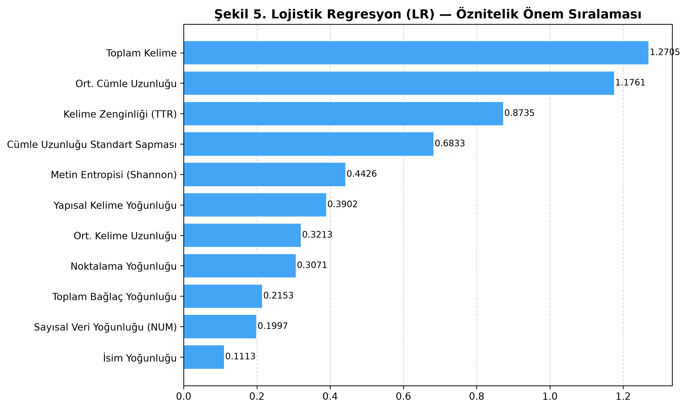
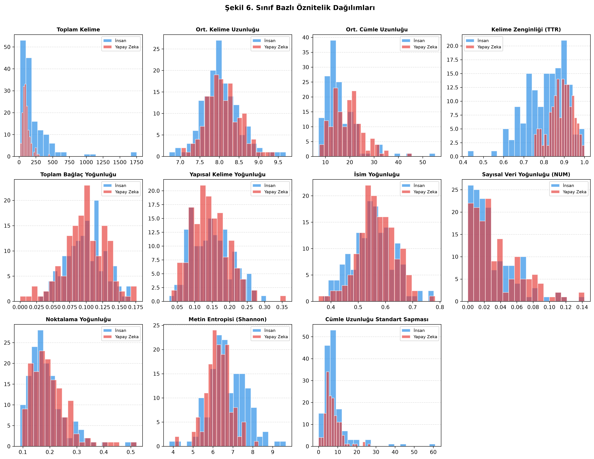

# 📰 Türkçe Haber Metinlerinde Yapay Zeka Tespiti (AI Text Detection in Turkish News)

[-red.svg)](https://stanfordnlp.github.io/stanza/)

Bu proje, Türkçe haber metinlerinin **insan yazımı** mı yoksa **üretken yapay zeka (LLM)** tarafından mı oluşturulduğunu tespit etmek amacıyla geliştirilmiş uçtan uca bir makine öğrenmesi ve doğal dil işleme (NLP) boru hattıdır.

---

## 📌 Proje Hakkında

Büyük dil modellerinin (LLM) gelişimiyle birlikte insan tarafından yazılmış içerikler ile yapay zeka tarafından üretilen metinler arasındaki farklar giderek belirsizleşmektedir. Bu çalışma; dilbilimsel, biçimbilimsel (morfolojik), sözdizimsel ve istatistiksel (entropi ve varyans) öznitelikleri bir araya getirerek Türkçe haber metinleri üzerinde yüksek başarımlı sınıflandırma modelleri geliştirmeyi amaçlar.

---

## 🔬 11 Boyutlu Genişletilmiş Öznitelik Kümesi

Metinlerden adli dilbilimsel ve yapısal düzeyde bilgi çıkarımı yapmak için **Stanford Stanza** Türkçe NLP boru hattı ve özel istatistiksel fonksiyonlar kullanılarak 11 boyutlu bir öznitelik vektörü elde edilir:

| # | Öznitelik Adı | Açıklama |
|---|---------------|----------|
| 1 | **Toplam Kelime** | Metindeki toplam kelime hacmi |
| 2 | **Ort. Kelime Uzunluğu** | Toplam karakter sayısının kelime sayısına oranı |
| 3 | **Ort. Cümle Uzunluğu** | Metindeki ortalama cümle başına düşen kelime sayısı |
| 4 | **Kelime Zenginliği (TTR)** | *Type-Token Ratio* (Benzersiz kelime sayısı / Toplam kelime sayısı) |
| 5 | **Toplam Bağlaç Yoğunluğu** | CCONJ, SCONJ, ADP etiketleri ve ulaç yapılarının (`VerbForm=Conv`) frekansı |
| 6 | **Yapısal Kelime Yoğunluğu** | Zarf (ADV), sıfat (ADJ), belirteç (DET) ve vasıta eki (`Case=Ins`) yoğunluğu |
| 7 | **İsim Yoğunluğu** | Özel isim (PROPN) ve cins isim (NOUN) bileşenlerinin toplam kelimeye oranı |
| 8 | **Sayısal Veri Yoğunluğu (NUM)** | Metindeki rakamsal veriler ve sayı etiketlerinin yoğunluğu |
| 9 | **Noktalama Yoğunluğu** | Toplam noktalama işaretlerinin kelime sayısına oranı |
| 10 | **Metin Entropisi (Shannon)** | Kelime dağılımının düzensizliğini ve bilgi yoğunluğunu ölçen Shannon Entropisi |
| 11 | **Cümle Uzunluğu Standart Sapması** | Cümle uzunluklarının varyasyonu (insan yazımındaki ritim çeşitliliğini ölçer) |

---

## 📊 Model Performansı ve Deneysel Sonuçlar

Veri seti %80 eğitim ve %20 test olmak üzere tabakalı (*stratified*) olarak bölünmüş, öznitelikler standartlaştırılmış (`StandardScaler`) ve 5-katlı çapraz doğrulama (5-Fold CV) ile sınanmıştır.

| Model | Doğruluk (Accuracy) | Kesinlik (Precision) | Duyarlılık (Recall) | F1-Skor | 5-Katlı CV F1 (Ort ± Std) |
|---|:---:|:---:|:---:|:---:|:---:|
| **Destek Vektör Makineleri (SVM)** | **%78.33** | **%79.96** | **%78.33** | **%78.03** | 0.7067 ± 0.0343 |
| **Lojistik Regresyon (LR)** | %76.67 | %77.78 | %76.67 | %76.43 | **0.7197 ± 0.0358** |
| **eXtreme Gradient Boosting (XGBoost)** | %70.00 | %70.00 | %70.00 | %70.00 | 0.6683 ± 0.0248 |

---

## 📈 Görselleştirmeler ve Analizler

Eğitim sürecinde üretilen tüm grafikler `makale_gorseller/` klasörü altına yüksek çözünürlüklü (300 DPI) olarak kaydedilir:

### 1. Karmaşıklık Matrisleri (Confusion Matrices)
Modellerin insan (0) ve yapay zeka (1) sınıflarını doğru/yanlış tahmin etme dağılımları:

### 2. Model Performans Karşılaştırması
Tüm modellerin temel metrikler bazındaki karşılaştırmalı sütun grafiği:

  

### 3. ROC Eğrileri ve AUC Değerleri
Modellerin ayırt edicilik gücünü gösteren ROC eğrileri:

  

### 4. Öznitelik Önem Sıralamaları
Her bir modelin karar verirken en çok ağırlık verdiği öznitelikler:

  
  

### 5. Sınıf Bazlı Öznitelik Dağılımları
Özniteliklerin insan ve yapay zeka metinlerindeki ayrışım dağılımları:

---
